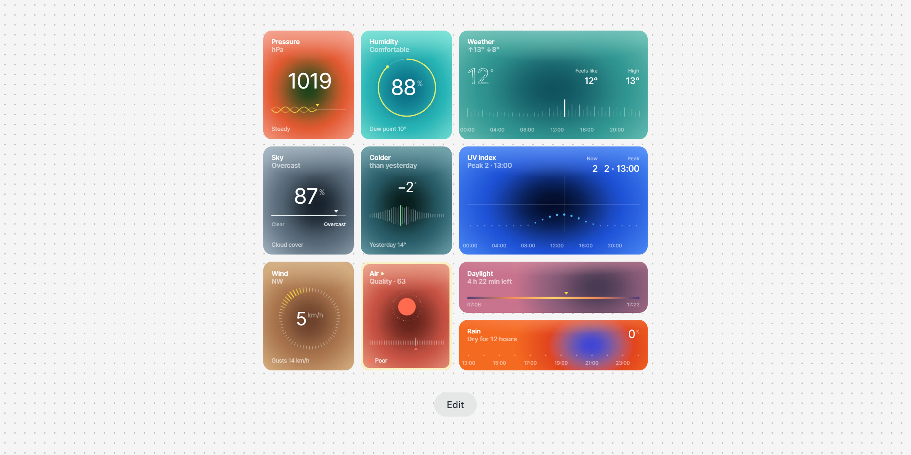
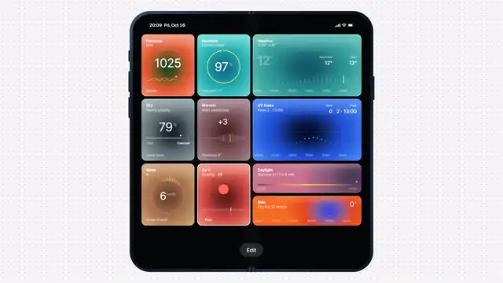

<p align="center">
  
</p>

<p align="center">
  <a href="https://likemiens.com/ui/aura"><b>Live demo</b></a> ·
  <a href="media/demo.mp4"><b>Video</b></a> ·
  <a href="#quick-start"><b>Quick start</b></a>
</p>

<p align="center">
  Made by Likemiens ·
  <a href="https://x.com/a_varantsov">X</a> ·
  <a href="https://t.me/Likemiens">Telegram</a> ·
  <a href="https://github.com/Likemiens">GitHub</a>
</p>

**aura** is glowing tiles for live numbers: a reading on its scale, a small chart, and a colour that follows the value. Put them on a board, and people rearrange them like widgets on a phone.

It is two Web Components, `<aura-tile>` and `<aura-board>`, in one file with no dependencies. Give the tiles your own numbers, or call `bindWeather()` and they show today's weather.

<p align="center">
  
</p>

## Features

- **Ten gauges.** A ring, a dial, a wave, a ruler and six more: each a number on its scale with a small chart. Point at a forecast to read any hour.
- **Colour that follows the value.** Twelve tones, and scales that warm the glow up as the temperature rises or the air gets worse.
- **Weather in one call.** `bindWeather()` fills tiles with the temperature, wind, rain, air quality and seven more readings from Open-Meteo. No key, no server.
- **A board you can edit.** Hold a tile or press Edit: drag to move, pull a corner to widen, − to hide. The board can remember the layout.
- **Every state.** Loading, no data, an error with retry, stale data, and an alert that pulses past a threshold.
- **One file, any website.** ~24 KB gzipped, no framework, no build step. Works with the keyboard and screen readers, respects "reduce motion".

## Quick start

Paste this anywhere in your HTML:

```html
<script type="module" src="https://cdn.jsdelivr.net/gh/Likemiens/aura@v1.0.1/aura.js"></script>

<aura-board editable persist="home">
  <aura-tile metric="temperature" span="2"></aura-tile>
  <aura-tile metric="air"></aura-tile>
  <aura-tile id="disk" kind="ring" label="Disk" sublabel="Used" unit="%" tone="percent"></aura-tile>
</aura-board>
<a href="https://open-meteo.com/">Weather data by Open-Meteo.com</a>

<script type="module">
  import { bindWeather } from "https://cdn.jsdelivr.net/gh/Likemiens/aura@v1.0.1/aura.js";

  bindWeather(document.querySelector("aura-board"), { place: "Berlin" });

  const disk = document.getElementById("disk");
  disk.update({ value: 81, alert: 90 });
  disk.addEventListener("aura-select", (event) => console.log(event.detail));
</script>
```

Open the page: the first two tiles show today's weather in Berlin, the third your own number. Hold a tile or press **Edit** to move, widen or hide tiles; the board remembers it.

Or load `https://likemiens.com/ui/aura/aura.js`: the file the live demo runs, always the latest version.

### Your own data

Set everything as attributes, or as one object:

```js
const sales = document.getElementById("sales"); // <aura-tile id="sales"></aura-tile>

sales.data = {
  kind: "ruler", label: "Sales", sublabel: "Today", unit: "k", tone: "coral",
  series: [64, 80, 97, 110, 128], times: ["9:00", "10:00", "11:00", "12:00", "13:00"], at: 4,
  caption: "Best since May",
};

sales.update({ caption: "A record" }); // changes a part, the rest stays
```

Attributes win over data. Keep the look (`kind`, `tone`) in attributes and the live values in data.

### With a bundler

```bash
npm install github:Likemiens/aura
```

```js
import { bindWeather } from "aura"; // registers <aura-tile> and <aura-board>
```

Import it in the browser only: the module defines its elements as it loads. With server rendering, import it in `useEffect`, `onMounted` or the like.

### React

React 19 passes the attributes as they are. Give data and listen to events through a ref:

```jsx
import { useEffect, useRef } from "react";
import "aura";

export function Disk({ used }) {
  const tile = useRef(null);
  useEffect(() => tile.current.update({ value: used }), [used]);
  return <aura-tile ref={tile} kind="ring" label="Disk" unit="%" tone="percent" />;
}
```

[AGENTS.md](AGENTS.md) has recipes for Next.js and a live dashboard.

## Tiles

Every option is an attribute and a key of `tile.data`, except `span` and `metric`, which are attributes only. In an attribute, a list is written with commas: `series="3, 5, 8"`.

| Option | Default | What it does |
|---|---|---|
| `kind` | `ring` | The gauge, one of [ten](#kinds) |
| `label`, `sublabel`, `caption` | — | The two lines at the top and the line at the bottom |
| `value` | — | The reading. With no `value`, `text` or `series`, the tile shows "No data" |
| `min`, `max` | `0`, `100` | The scale. With a `series`, its lowest and highest points |
| `unit`, `decimals` | —, auto | After the number: `°`, `%`, `km/h`. Digits after the point: one for small fractions, else none |
| `text` | — | Words in place of the number |
| `series`, `times`, `at` | — | Points of a chart, their labels and the current one. Without a `value`, the point at `at` is the reading |
| `ends` | — | Two labels at the ends of the scale: `ends="Clear, Overcast"` |
| `angle`, `spread` | the value, `0.4` | `dial`: where the mark points, degrees clockwise from the top; how wide it is, 0–1 |
| `color` | the accent | `swatch`: the colour of the dot |
| `stops` | rim to accent | `meter`: the colours of the bar, left to right |
| `facts` | — | Readings a wide tile shows on its right: `facts="Gusts: 16 km/h, From: NE"` |
| `tone` | `teal` | A palette, a scale that colours by the value, or four colours. See [Tones](#tones) |
| `state` | `ready` | `loading`, `empty`, `error` or `stale` |
| `message` | built in | What the tile says instead of its caption when empty, in error or stale |
| `alert` | — | A threshold: at or above it the tile pulses. `alert` alone: always |
| `size` | `tall` | `short`: half the height |
| `numerals` | — | `dotted`: digits drawn with dots |
| `span` | `1` | Columns on a board, 1–4 |
| `metric` | — | What [`bindWeather()`](#weather) puts here |

### Kinds

| Kind | What it draws | In the weather |
|---|---|---|
| `ring` | An arc round the number | humidity |
| `dial` | Ticks round the number, a lit mark at `angle` | wind and its direction |
| `wave` | A wave up to the reading, a still line after it | pressure |
| `ruler` | A tick for each point of `series` | the temperature through the day |
| `split` | A line between two `ends`, filled up to the reading | cloud cover |
| `pulse` | Ticks that peak at the reading, a mark at zero; the number has a sign | warmer or colder than yesterday |
| `scatter` | A dot for each point, higher and larger as it grows | UV through the day |
| `swatch` | A dot of `color` over a scale | air quality |
| `meter` | A bar in the `stops` colours, a mark at the reading | UV now, daylight |
| `dots` | A row of dots that grow with the value | the chance of rain |

`ruler`, `scatter` and `dots` can be scrubbed: point at them, or press ← → on a focused tile, to read each point.

### Tones

- **Palettes:** `coral` `teal` `red` `lime` `magenta` `blue` `sand` `moss` `mauve` `ember` `slate` `ice`.
- **Scales** colour a tile by its value and mix the tones between their stops: `temperature` (°C), `uv`, `aqi`, `clouds`, `delta`, `percent`.
- **Your own:** four colours for the rim, the glow, the heart and the marks, `tone="#f39a86, #e2552e, #163f18, #f6e04b"`. Or, in data, a scale: `tone: [[0, "moss"], [50, "sand"], [100, "red"]]`.

### Sizes

A tile lays itself out by its own width. One column wide, it is a small widget. Two and more, it is a wide one: the number on the left, the `facts` on the right, the chart across. On a board, `span` sets the columns.

On its own, a tile is as wide as its container and keeps the shape of a small widget, 200∶236 (200∶112 when `short`). Give it a width, and an `aspect-ratio` such as `2` to make it wide.

## Board

`<aura-board>` lays out the tiles inside it, its direct children, in a grid: 2 columns when it is narrow, 3 from 520 px, 4 from 760 px.

| Attribute | What it does |
|---|---|
| `editable` | An **Edit** button under the tiles, and a long press on a tile, start editing: drag to move, pull the corner to widen, − to hide, ✓ to keep, ✕ to undo |
| `persist` | A name. The layout (order, hidden tiles, widths) is kept in `localStorage` as `aura-board:<name>` and comes back on the next visit. A tile added since keeps its own width and `hidden` |
| `lang` | `ru` for Russian labels. Read from the nearest `[lang]` |

On the keyboard, while editing: Tab to a tile, arrows move it, Shift with ← → changes its width, Delete hides it or brings it back, Enter keeps the layout, Esc undoes.

A board knows a tile by its `id`, or else its `metric` or `label` attribute. Give every tile a different one.

## Weather

`bindWeather(root, options)` fills every `<aura-tile metric="…">` inside `root` (a board, or any element) from [Open-Meteo](https://open-meteo.com/), straight from the browser, with no key. It updates every 10 minutes, and when the tab comes back after that. Tiles show `loading` until the first answer and `error` if it fails (a click retries). If a later update fails, they turn `stale` and say when the last reading was.

| Option | Default | What it does |
|---|---|---|
| `lat`, `lon` | — | The place |
| `place` | — | Or a city to look up: `"Berlin"` |
| `units` | `metric` | `imperial`: °F and mph |
| `lang` | the page's | `en` or `ru`. In Russian, pressure is in mm Hg and wind in m/s |
| `every` | `600` | Seconds between updates. `0`: only when you call `refresh()` |

| `metric` | What the tile shows |
|---|---|
| `temperature` | The temperature now, how it feels, the day's high and low; the hours of the day |
| `delta` | Warmer or colder than at this hour yesterday |
| `humidity` | Relative humidity, and how it feels by the dew point |
| `pressure` | Sea-level pressure: rising, falling or steady over 3 hours |
| `clouds` | Cloud cover, the sky in words, the low, middle and high layers |
| `uv-day` | The UV index through the day and its peak |
| `uv` | The UV index now (a short tile) |
| `wind` | Speed, direction and gusts |
| `air` | The European air quality index, PM2.5 and PM10 |
| `daylight` | Daylight left, or the time to sunrise (a short tile) |
| `rain` | The chance of rain over the next 12 hours (a short tile) |

```js
const weather = bindWeather(board, { place: "Berlin" });

weather.set({ place: "Lisbon" });   // another city: the tiles load again
weather.set({ units: "imperial" }); // other units, or another language
weather.refresh();                  // update now
weather.stop();                     // no more updates
weather.weather;                    // the last Open-Meteo answer
```

`findPlaces(name, lang, count)` looks a city up: `[{ name, country, lat, lon }]`, the best match first.

> [!IMPORTANT]
> The weather data is Open-Meteo's, under CC BY 4.0: put "Weather data by Open-Meteo.com" with a link near the tiles. Their free API is for non-commercial use.

## Events

| Event | From | `detail` | When |
|---|---|---|---|
| `aura-select` | a tile | `{ key, value, index, data }` | A click, Enter or Space. `index` is the point being scrubbed, or `null` |
| `aura-scrub` | a tile | `{ key, index, value, time }` | The pointer or the arrows reach another point of the chart |
| `aura-retry` | a tile | `{ key }` | A click on a tile in `error`. `bindWeather()` answers it with an update |
| `aura-toggle` | a tile | `{ key, hidden }` | − or + on a tile, or Delete, while editing |
| `aura-edit` | the board | `{ editing }` | Editing starts or ends |
| `aura-change` | the board | `{ order, hidden, spans }` | ✓ keeps a layout. A good moment to save it |
| `aura-resize` | the board | `{ key, span }` | A tile changes its width |
| `aura-weather` | the root of `bindWeather()` | `{ place, time, offset, weather }` or `{ error }` | After every update |

They all bubble out of the shadow DOM, so one listener on the board hears every tile. `key` is the tile's `id`, `metric` or `label`.

## Styling

Set these on a tile, on the board or on any parent:

| Property | Default | What it does |
|---|---|---|
| `--aura-edge`, `--aura-mid`, `--aura-core`, `--aura-accent` | from `tone` | The four colours by hand: rim, glow, heart, marks |
| `--aura-ink` | `#fff` | Text and numbers |
| `--aura-font` | the page's | The font |
| `--aura-radius` | 12–28 px, by size | The corners |
| `--aura-focus` | `#0c75f1` | The focus ring |
| `--aura-columns` | 2–4, by width | The board's columns |
| `--aura-gap` | `10px` | Space between tiles |
| `--aura-row` | `0.56` | Row height, as a share of a column. A tile takes two rows, a short one one |
| `--aura-bar-bg`, `--aura-bar-ink` | grey glass, white | The Edit button. Set them on a light page |
| `--aura-bar-gap` | `24px` | Space above the Edit button |

For anything else, `::part()` reaches inside. A tile has `tile`, `viz`, `label`, `sublabel`, `caption`, `badge` (− and +) and `grip`; the board has `grid`, `toolbar`, `edit`, `cancel` and `done`.

## JavaScript API

```js
import { bindWeather, findPlaces, toneAt, TONES, SCALES } from "aura";

const tile = document.querySelector("aura-tile");
tile.data = { kind: "ring", label: "Disk", value: 81, unit: "%" }; // replaces the data
tile.update({ value: 84 }); // merges a part
tile.data;                  // a copy of the data

const board = document.querySelector("aura-board");
board.tiles;                // the tiles, in order
board.layout;               // { order, hidden, spans }: save it anywhere
board.layout = saved;       // and put it back
board.edit();               // editing from code; done() keeps, cancel() undoes
board.editing;              // true while editing

toneAt("temperature", 24);  // the four colours of a scale at a value
```

Types are in `aura.d.ts`: the tags, the events and the exports.

## Browser support

Current Chrome, Edge, Firefox and Safari, on desktop and on phones. The tiles need container queries and `color-mix()`, so the oldest versions are Chrome and Edge 111, Firefox 113 and Safari 16.2. Where a browser can't animate colours (`CSS.registerProperty`), a new tone switches instead of gliding.

## Files

```
aura.js        the tiles, the board and the weather: one ES module, no dependencies
aura.d.ts      TypeScript types
example.html   a weather board and a tile of your own numbers; serve the folder and open it
media/         the cover, the preview and the video
AGENTS.md      notes for coding agents
```

## Author

Made by **Likemiens**. Say hi or share what you built: [X](https://x.com/a_varantsov) · [Telegram](https://t.me/Likemiens) · [GitHub](https://github.com/Likemiens)

## License

[MIT](LICENSE) © Likemiens
